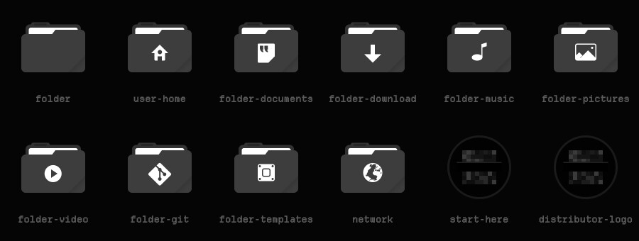

# Redacted — Icons

Charcoal folder and places icons and a censored-face launcher icon, layered over Tela circle dark.



Redacted is a monochrome-black look for KDE Plasma 6 about obfuscation and censorship. Every colour is a neutral grey, and the accents sit only a few levels above black: almost imperceptible, but just perceptible. The motifs are static, mosaic pixelation, black censor bars and a dissociated double.

## Features

- Every folder and places icon (home, downloads, music, git, trash and the rest) is recoloured to charcoal with pale grey glyphs.
- The app-launcher icon is a static-filled disc under a censor bar, used for every `start-here` and `distributor-logo` name, symbolic ones included.
- Every other icon is inherited from **Tela circle dark**, then breeze-dark.


## Requirements

[Tela circle icon theme](https://github.com/vinceliuice/Tela-circle-icon-theme), dark variant (`Tela-circle-dark`), installed alongside.

## Install

```bash
git clone https://github.com/numbpill3d/redacted-icons
cd redacted-icons && ./install.sh
```

Or from the KDE Store: Install Tela-circle-dark first. Then extract this to `~/.local/share/icons/` and pick **Redacted** in System Settings → Colors & Themes → Icons.

## The rest of the suite

| piece | repo |
|---|---|
| Global theme + splash screen | [redacted-global](https://github.com/numbpill3d/redacted-global) |
| Plasma style (panel, popups) | [redacted-plasma](https://github.com/numbpill3d/redacted-plasma) |
| Aurorae window decoration | [redacted-aurorae](https://github.com/numbpill3d/redacted-aurorae) |
| Colour scheme | [redacted-colors](https://github.com/numbpill3d/redacted-colors) |
| Kvantum widget style | [redacted-kvantum](https://github.com/numbpill3d/redacted-kvantum) |
| Konsole + kitty colours | [redacted-konsole](https://github.com/numbpill3d/redacted-konsole) |
| SDDM login | [redacted-sddm](https://github.com/numbpill3d/redacted-sddm) |
| Plymouth boot splash | [redacted-plymouth](https://github.com/numbpill3d/redacted-plymouth) |
| Animated wallpaper (desktop + lock) | [redacted-wallpaper](https://github.com/numbpill3d/redacted-wallpaper) |
| Still wallpaper (1080p–4K) | [redacted-image-wallpaper](https://github.com/numbpill3d/redacted-image-wallpaper) |
| KWin open/close effect | [redacted-censor](https://github.com/numbpill3d/redacted-censor) |
| KWin script: active window under review | [redacted-static](https://github.com/numbpill3d/redacted-static) |
| Clock plasmoid | [redacted-clock](https://github.com/numbpill3d/redacted-clock) |

Everything at once, with the generators: [redacted-kde](https://github.com/numbpill3d/redacted-kde).

## Tags

`redacted` `kde` `plasma6` `dark` `black` `monochrome` `grayscale` `minimal` `censored` `glitch` `static` `pixel` `icon-theme` `icons` `folders` `tela` `grey-folders`

## Credits and licence

By splicer scorn (voidrane). GPL-3.0-or-later.
Folder artwork recoloured from Tela circle icon theme by Vince Liuice (GPL-3.0).
